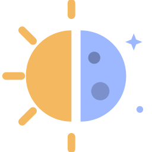

  
  <h1 align="center">Solstice</h1>
  <h4 align="center">A Windows-focused fork of <a href="https://github.com/LizardByte/Sunshine">Sunshine</a>, tuned for streaming to a Nintendo Switch.</h4>

  
  
  

## ℹ️ About

Solstice is a personal fork of [Sunshine](https://github.com/LizardByte/Sunshine), the self-hosted game stream host
for Moonlight. It keeps everything Sunshine does and adds features aimed at one setup: a Windows PC with an NVIDIA GPU
streaming to [Moonlight-Switch](https://github.com/luizfbalves/Moonlight-Switch).

It follows upstream Sunshine and is not affiliated with or endorsed by LizardByte. For everything that is not listed
below, the [Sunshine documentation](https://docs.lizardbyte.dev/projects/sunshine) applies.

## ✨ What's different

### 🎮 Switch controller emulation

* The PC can see a **Switch 2 Pro Controller** instead of an Xbox controller, so Steam and games show Nintendo buttons.
* Uses [libVIIPER](https://github.com/Alia5/VIIPER) on top of the Microsoft-signed
  [usbip-win2](https://github.com/vadimgrn/usbip-win2) driver: no test signing and no Secure Boot changes.
* Buttons map by position, analog sticks, motion (gyro and accelerometer) and HD rumble are forwarded.
* Falls back to ViGEmBus automatically if VIIPER is unavailable.

### 🕹️ Gamepad type per game

* Each application can choose its emulated gamepad: global setting, automatic, Switch, Xbox 360 or DualShock 4.
* With the global setting on `auto`, the client decides: the **Switch** layout in Moonlight-Switch gets a Switch
  controller, the Xbox layouts get an Xbox 360 controller.

### 🖥️ Streaming

* The NVIDIA driver frame rate limiter is capped to the stream's FPS while streaming, and restored afterwards.
* Display modes are kept across display power-off, and transient display loss no longer ends the stream.

### 🖥️ Virtual display

* Optionally streams a dedicated virtual monitor at the exact resolution and refresh rate the client asked for, using the
  bundled [SudoVDA](https://github.com/SudoMaker/SudoVDA) driver (installed by the Windows installer). Off by default;
  falls back to the physical display if the driver is missing.
* The installer adds the driver certificate (`sudovda.cer`) to the machine Root and TrustedPublisher stores.
  Uninstall removes only the device node; `docs/legal.md` shows how to remove the certificate manually.

### 🌐 Web UI

* Redesigned screens, with applications shown as a cover grid.
* One click finds missing covers for every application.
* Update checks point to Solstice releases, so the UI never offers an upstream build that would drop these features.

## 📦 Install

1. Install [usbip-win2](https://github.com/vadimgrn/usbip-win2/releases) (needed only for Switch controller emulation)
   and reboot if asked.
2. Download `Sunshine-<version>-Windows-AMD64-installer.msi` from the
   [latest release](https://github.com/luizfbalves/Solstice/releases/latest) and install it.
   `libVIIPER.dll` is bundled.
3. In the web UI, go to **Configuration → Input** and set:
   * **Gamepad driver**: `viiper`
   * **Emulated gamepad type**: `auto`
4. On the Switch, use [Moonlight-Switch](https://github.com/luizfbalves/Moonlight-Switch) 1.5.3 or newer and pick
   the **Switch** key mapping layout.

> [!TIP]
> If Solstice was installed over a winget-managed Sunshine, run `winget pin add --id LizardByte.Sunshine --blocking`
> so `winget upgrade` does not replace it with upstream Sunshine.

## 🔧 Configuration

| Option                          | Where                       | Values                                    |
|---------------------------------|-----------------------------|-------------------------------------------|
| `gamepad_driver`                | `sunshine.conf`             | `viiper` enables Switch controller emulation |
| `gamepad`                       | `sunshine.conf`             | `auto`, `switch`, `x360`, `ds4`           |
| `nvenc_frame_limiter`           | `sunshine.conf`             | `enabled` caps the NVIDIA frame limiter to the stream FPS |
| `gamepad` (per app)             | `apps.json` / Applications  | empty (global), `auto`, `switch`, `x360`, `ds4` |

## 🛠️ Building

Releases are built by the [Windows workflow](.github/workflows/fork-windows.yml) on every push to `master`. To build
locally, follow the [Sunshine build guide](docs/building.md)
with MSYS2 UCRT64, and pass `-DSUNSHINE_VIIPER_DLL=<path to libVIIPER.dll>` to bundle libVIIPER in the package.

## 🙏 Credits

Solstice exists thanks to the work of others:

* **[Sunshine](https://github.com/LizardByte/Sunshine)** by [LizardByte](https://github.com/LizardByte) and its
  contributors: the streaming host this fork is built on. Please support the original project.
* **[VIIPER](https://github.com/Alia5/VIIPER)** by Alia5: the virtual USB device library behind Switch controller
  emulation.
* **[usbip-win2](https://github.com/vadimgrn/usbip-win2)**: the signed USB/IP driver that makes the virtual
  controller visible to Windows.
* **[ViGEmBus](https://github.com/nefarius/ViGEmBus)** by Nefarius: the Xbox and DualShock 4 fallback.
* **[Moonlight](https://moonlight-stream.org)** and **[Moonlight-Switch](https://github.com/XITRIX/Moonlight-Switch)**
  by XITRIX: the clients on the other end.

### Sunshine contributors

  

  

## 📄 License

Solstice is licensed under the [GNU General Public License v3.0](LICENSE), the same license as Sunshine. Third-party
notices are listed in [NOTICE](NOTICE).
